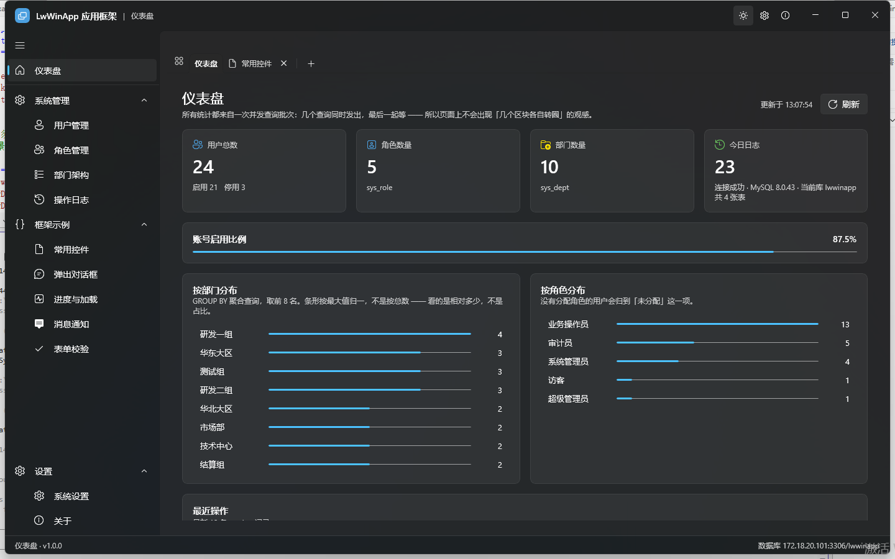
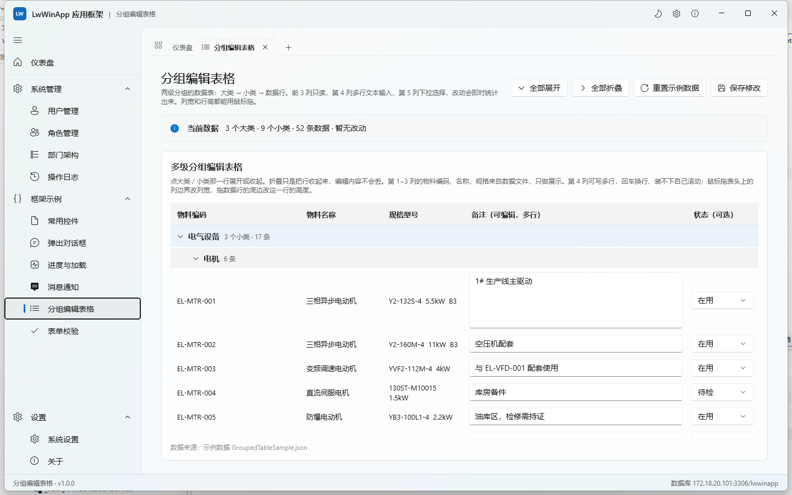

# LwWinApp — WinUI 3 桌面应用框架


一套**可直接作为新项目起点**的 WinUI 3 应用框架：左侧一级导航 + 顶部多标签二级导航的外壳、接 MySQL 的 ViewModel 与泛型仓储数据层、常用工具库，以及覆盖常用控件与弹出交互的示例页面。

不用 MSIX 打包，编译产物里的 `LwWinApp.exe` 双击就能跑。


## 特性一览

| | |
|---|---|
| **外壳** | `NavigationView` 一级导航 + `TabView` 二级标签，**每个标签持有独立 `Frame`**（切走再切回，筛选条件与结果都还在）；`Ctrl+数字` 切标签、`Ctrl+W` 关标签、`+` 按分组开新页 |
| **数据层** | 泛型 `RepositoryBase<T>` + 按表的具体仓储 + `IUnitOfWork` 事务；表名与主键按约定解析并缓存，下划线列名全局映射打开；Dapper + MySqlConnector |
| **服务层** | 对话框（内部排队，同一时刻只开一个）、标签导航、主题、窗口、通知、文件选择，以及**弹窗窗口** |
| **示例页** | 常用控件、弹出对话框、弹窗窗口、进度与加载、消息通知、分组编辑表格、表单校验 —— 每个都带着「为什么这么写」的注释 |
| **业务页** | 仪表盘、用户管理（增删改查 + 分页 + 导出）、角色管理、部门架构、操作日志（审计） |
| **工程化** | 无打包 + 自带运行时；文件日志；PBKDF2 口令哈希（兼容旧格式并就地升级）；`tools/` 里有 UIA 走查与截图脚本 |

## 目录

- [特性一览](#特性一览) · [截图](#21-截图) · [技术栈与依赖](#技术栈与依赖) · [贡献](#贡献) · [许可](#许可)
- [1. 环境与运行](#1-环境与运行)
- [2. 目录结构](#2-目录结构) · [2.1 截图](#21-截图)
- [3. 外壳：两级导航](#3-外壳两级导航)
- [4. 数据访问层](#4-数据访问层)
- [5. 服务层](#5-服务层)
- [6. 工具库（`Utils/`）](#6-工具库utils)
- [7. 配置](#7-配置)
- [8. 扩展指南](#8-扩展指南) —— 加页面 / 加表 / 加对话框 / 加弹窗窗口
- [9. 踩过的坑](#9-踩过的坑都是实测出来的改框架时别踩回去) —— **最省时间的一节**
- [10. 验证状态](#10-验证状态)

## 技术栈与依赖

| 包 | 版本 | 用途 |
|---|---|---|
| `Microsoft.WindowsAppSDK` | 2.5.1 | WinUI 3 本体：窗口、控件、Mica、`AppWindow` |
| `Microsoft.Windows.SDK.BuildTools` | 10.0.28000.2705 | XAML 编译器与 SDK 工具链 |
| `CommunityToolkit.Mvvm` | 8.4.2 | 源生成器：`[ObservableProperty]` / `[RelayCommand]` / `[NotifyPropertyChangedFor]` |
| `Dapper` | 2.1.86 | 轻量 ORM，仓储层用它做映射 |
| `MySqlConnector` | 2.6.2 | MySQL 异步驱动（自带连接池） |
| `Microsoft.Extensions.Hosting` | 10.0.12 | DI 容器 + 配置 + 日志宿主 |
| `Microsoft.Extensions.Configuration.Json` | 10.0.12 | 读 `appsettings.json` 与环境变量覆盖 |

**依赖刻意很少，而且是有意为之。** 两处最容易被「顺手加个库」的地方，本项目都选择了自己写：

- **表格不用第三方 `DataGrid`。** 示例页要演示的是「两级分组 + 行内编辑 + 行列拖拽 + 虚拟化」，
  这些需求凑到一起，任何现成控件的模板都得改到面目全非；反而是自己用 `ListView` + `TableLayout`
  实现一份（见第 9 节「表格的行列拖拽」），行为完全可控，也少一层升级时要跟着改的黑盒。
- **窗口不引 UI 框架。** WinUI 3 缺的那几样（窗口圆角、最小尺寸、暗色标题栏、属主关系、模态）
  都是 Win32 一次性调用，集中在 `Utils/WindowHelper` 里，比引一整个窗口库划算。

新增依赖前先想清楚：这个库解决的是一行 P/Invoke 还是真的一个模块？赢不了 `Utils/` 里那几十行，
就别加。

---

## 1. 环境与运行

| 项 | 值 |
|---|---|
| 目标框架 | `net8.0-windows10.0.19041.0`（最低支持 Windows 10 1809 / 17763） |
| 平台 | 默认 x64；`Platforms=x86;x64;ARM64`，发布配置见 `Properties/PublishProfiles/` |
| Windows App SDK | 2.5.1（`WindowsAppSDKSelfContained=true`，自带运行时） |
| 打包方式 | 无打包（`WindowsPackageType=None`） |
| 数据库 | MySQL 8.0（连接串在本地配置文件里，见下） |

```bash
# 1. 建本地配置 —— appsettings.json 不跟踪，仓库里只有模板
cp LwWinApp/appsettings.example.json LwWinApp/appsettings.json
#    然后把里面的 Server / Uid / Pwd 改成你自己的

# 2. 编译（-p:Platform=x64 别省，理由见下）
dotnet build LwWinApp/LwWinApp.csproj -c Debug -p:Platform=x64

# 3. 运行（无需 MSIX，直接启动 exe）
LwWinApp/bin/x64/Debug/net8.0-windows10.0.19041.0/win-x64/LwWinApp.exe
```

**`-p:Platform=x64` 不能省。** `WindowsAppSDKSelfContained` 只接受 x86/x64/ARM64，
而 `dotnet build` 不带参数时 `Microsoft.Common.props` 早已把 `Platform` 置为 `AnyCPU`，
会直接报 `requires a supported Windows architecture`。csproj 里补了一个默认值兜底
（裸跑 `dotnet run` 也能用），但命令行显式给全局属性最稳妥。

**`appsettings.json` 不进仓库。** 它里面有真实的数据库地址和口令，属于本机文件；
仓库里放的是占位符版本的 `appsettings.example.json`。配置项缺失不会让应用起不来
（`AddJsonFile` 是 `optional: true`，csproj 里的 `Content` 项也带 `Exists` 条件），
只是第一次用数据库时会报连接失败。

### 首次运行的数据库准备

```bash
mysql -h 127.0.0.1 -P 3306 -u root -p lwwinapp < LwWinApp/Sql/init.sql
```

脚本可重复执行：建表用 `CREATE TABLE IF NOT EXISTS`，插数据用 `INSERT IGNORE`。
它会建出 4 张表并写入种子数据：

| 表 | 用途 | 种子量 |
|---|---|---|
| `sys_dept` | 部门（`parent_id` 自关联，供 TreeView 演示层级） | 10 行，3 层 |
| `sys_role` | 角色 | 5 行 |
| `sys_user` | 用户 | 24 行 |
| `sys_log` | 操作日志（供大表格 + 分页演示） | 数十行，随时间增长 |

**演示账号**：`admin` / `123456`（所有种子用户密码相同）。

种子里的密码是 `SHA256(明文 + 盐)` 的历史格式，盐见 `appsettings.json` 的 `App:PasswordSalt`。
新改的密码会用 `PBKDF2$迭代次数$盐$哈希`（PBKDF2-SHA256，21 万次迭代、每用户独立随机盐）写入；
`PasswordHasher.Verify` 同时认两种格式，`NeedsUpgrade` 用来判断是否需要就地把老哈希升级掉。

---

## 2. 目录结构

```
LwWinApp/                       # 仓库根（LwWinApp.slnx 所在）
├─ README.md                    # 本文件
├─ CONTRIBUTING.md              # 环境准备、代码风格、提 PR 之前的检查项
├─ CHANGELOG.md                 # 更新日志
├─ CLAUDE.md                    # 给 Claude Code 的项目导航（目录地图 + 不能违反的约定）
├─ LICENSE                      # MIT
├─ .github/workflows/build.yml  # CI：push / PR 时在 windows-latest 上编一遍
├─ docs/screenshots/            # 走查截图
├─ tools/                       # 自动化走查脚本，见 tools/README.md
└─ LwWinApp/                    # 项目
   ├─ App.xaml(.cs)             # 入口：组装 DI 容器 + 创建主窗口（界面逻辑一律不写在这里）
   ├─ MainWindow.xaml(.cs)      # Shell：NavigationView（左侧一级）+ TabView（顶部二级）
   ├─ appsettings.json          # 本机的连接串 / 分页 / 主题 / 日志配置（**不跟踪**，见第 7 节）
   ├─ appsettings.example.json  # 上面那个文件的模板，占位符版本
   ├─ Core/                     # 常量、配置模型、枚举、BusinessException
   ├─ Models/
   │   ├─ Entities/             # 与数据库表一一对应的实体
   │   └─ Dtos/                 # PagedResult<T> / QueryFilter / SelectOption / 统计模型
   ├─ Data/                     # 数据访问框架：连接工厂、泛型仓储、工作单元、具体仓储
   ├─ Services/                 # 对话框、标签导航、主题、窗口、通知、文件选择、弹窗窗口、业务服务
   ├─ Utils/                    # 常用工具库（见第 6 节）
   ├─ Controls/                 # Pager / BusyOverlay / PageHeader / TableGrid 自建控件
   ├─ Navigation/PageCatalog.cs # 页面登记表：二级导航的唯一事实来源
   ├─ ViewModels/               # 各页面 ViewModel（+ Demo/ 子目录）
   ├─ Views/                    # Shell 页 / Demo 示例页 / System 业务页 / Settings / Dialogs / Windows
   ├─ Themes/                   # Colors.xaml / Styles.xaml / Icons.xaml
   └─ Sql/init.sql              # 建表 + 种子数据
```

## 2.1 截图

`docs/screenshots/` 里是走查时抓的实机截图（1440×900）。这些都是**真跑起来截的**，
不是设计稿 —— 第 9 节里好几条坑就是靠比对截图才发现的（比如危险确认框的警示色其实没生效）。

| 深色主题 | 分组编辑表格 |
|---|---|
|  |  |

完整清单：

| 文件 | 内容 |
|---|---|
| `01-主界面-仪表盘.png` | Mica + 左侧一级导航 + 顶部标签栏 + 仪表盘（真实聚合查询） |
| `02-用户管理.png` | 四个筛选框 + 自建表格 + 分页 + 行内操作按钮 |
| `03-常用控件.png` | ComboBox / CheckBox / RadioButton / ToggleSwitch 及其联动 |
| `04-部门架构.png` | TreeView 三层真实层级（`parent_id` 自关联） |
| `05-深色主题.png` | 深色下 Mica / 导航 / 卡片 / 状态栏同步 |
| `06-系统设置.png` | 主题、窗口记忆、目录、数据库连接信息 |
| `07-危险确认框.png` | `danger: true`：主按钮警示色、无默认按钮 |
| `08-普通确认框.png` | 普通确认：主按钮 accent 色、回车即确认 |
| `09-分组编辑表格.png` | 两级分组表格：表格铺满窗口剩余高度；第 1 列拖宽过（表头与数据行仍对齐）、第 1 行拖高过（备注框能装多行） |
| `10-消息通知-InfoBar四种级别.png` | 四种严重级别的 InfoBar：底部换成实色（品牌蓝 / 绿 / 棕黄 / 红）+ 白字 + 白叉 |

`tools/` 里的脚本可以重新跑一遍这些截图，见 `tools/README.md`。

> **还缺一张**：「弹窗窗口」示例页（见第 3 节）是新加的，代码在，但还没在真机上走查过，
> 所以这里没有它的截图。走查完成后补一张 `11-弹窗窗口.png`，并把第 10 节里对应的条目从
> 「未走查」挪到「已验证」。

---

## 3. 外壳：两级导航

```
NavigationView（左侧一级，可展开的 NavigationViewItem）
├─ 仪表盘                      ← 常驻首页，不可关闭
├─ 系统管理  ▸ 用户管理 / 角色管理 / 部门架构 / 操作日志
├─ 框架示例  ▸ 常用控件 / 弹出对话框 / 弹窗窗口 / 进度与加载 / 消息通知 / 分组编辑表格 / 表单校验
└─ 设置      ▸ 系统设置 / 关于
TabView（顶部二级，每个 Tab 内嵌独立 Frame）
Frame → 页面
```

**每个标签持有自己的 `Frame`**，所以标签之间互不干扰：在「角色管理」里输入的筛选词，切到别的标签再切回来还在。

> 为什么不用 `TabItemsSource` + `DataTemplate`：TabView 会复用回收 `TabViewItem` 容器，而放在 DataTemplate 里的 `Frame` 属于**容器状态**，会被重建或复用，表现为「切换标签后显示的是别的页面」。因此 `TabNavigationService` 刻意用 `TabItems.Add` 手工添加条目。

键盘：`Ctrl+数字` 按索引选标签；标签栏的 `+` 按钮弹出一个按一级分组排列的菜单（已打开的项显示为禁用），底部有「关闭全部标签」。

---

## 4. 数据访问层

```
Service（业务校验 + 事务 + 写日志）
   ↓
IXxxRepository（各自的模糊搜索 / 按部门过滤 / 树形取数）
   ↓
RepositoryBase<T>（泛型 CRUD，反射 + 缓存解析表名与主键）
   ↓
IDatabaseFactory → MySqlConnection（MySqlConnector，自带连接池）
```

`IRepository<T>` 提供：

```csharp
Task<T?> GetByIdAsync(object id, ...)
Task<IReadOnlyList<T>> GetAllAsync(string? sortColumn = null, bool descending = false, ...)
Task<IReadOnlyList<T>> QueryAsync(string? where, object? param, string? sortColumn, bool descending, ...)
Task<T?> QueryFirstAsync(string where, object? param, ...)
Task<long> CountAsync(string? where = null, object? param = null, ...)
Task<bool> ExistsAsync(object id, ...)
Task<long> InsertAsync(T entity, IDbTransaction? tx = null, ...)   // 回填自增 ID
Task<int>  UpdateAsync(T entity, IDbTransaction? tx = null, ...)
Task<int>  DeleteAsync(object id, IDbTransaction? tx = null, ...)
Task<int>  DeleteWhereAsync(string where, object? param, ...)
Task<PagedResult<T>> QueryPagedAsync(...)                          // COUNT + LIMIT 两次查询
```

跨仓储事务用 `IUnitOfWork`：`BeginTransactionAsync` / `CommitAsync` / `RollbackAsync`，
仓储方法的 `tx` 参数接收它，把多次写入绑在同一个事务里。

**两个容易踩的坑，框架里已经处理掉了：**

- **下划线列名映射**：`MySqlDatabaseFactory` 的静态构造函数里设了 `DefaultTypeMap.MatchNamesWithUnderscores = true`。少了这一行，所有 `user_name`、`create_time` 都会静默映射成 null —— 不报错，只是字段全是空的。
- **表名与主键靠约定 + 特性解析**，解析结果按类型缓存，不走每次调用反射。表名默认取类名转下划线小写，可用 `Data/Annotations.cs` 里的特性覆盖。

---

## 5. 服务层

| 接口 | 职责 |
|---|---|
| `IDialogService` | 提示 / 确认 / 输入 / 进度 / 自定义 `ContentDialog`，内部排队，同一时刻只开一个 |
| `ITabNavigationService` | 标签的打开、激活、关闭、关闭其他、关闭全部 |
| `IThemeService` | 亮 / 暗 / 跟随系统，持久化到本地设置 |
| `IWindowService` | 标题栏、最小尺寸、居中、最大化、窗口状态记忆 |
| `INotificationService` | 全局 `InfoBar` 宿主 + 右下角轻提示 |
| `IFilePickerService` | 文件 / 文件夹选择、另存为（已处理未打包应用的初始化问题） |
| `IChildWindowService` | **弹窗窗口**：模态 / 非模态子窗口的显示与生命周期（认属主、锁属主、非模态计数） |
| `IWindowContext` | 给对话框等需要 `XamlRoot` 的服务提供根元素 |
| `IUserService` 等 | 业务服务：校验 + 仓储 + 密码哈希 + 写操作日志 |

`IDialogService` 的常用签名：

```csharp
Task ShowInfoAsync(string message, string? title = null);
Task ShowSuccessAsync(string message, string? title = null);
Task ShowWarningAsync(string message, string? title = null);
Task ShowErrorAsync(string message, string? title = null);
Task<bool>   ConfirmAsync(string message, string? title = null, string? primaryText = null, bool danger = false);
Task<string?> PromptAsync(string message, string? title = null, string? placeholder = null, Func<string, string?>? validate = null);
Task ShowProgressAsync(string title, Func<IProgress<...>, CancellationToken, Task> work, ...);
Task<ContentDialogResult> ShowCustomAsync(ContentDialog dialog, ...);
```

`PromptAsync` 的 `validate` 返回 `null` 放行，返回文字则显示为红字并**把对话框留住**，用户已经输入的内容一个字都不会丢。

`ConfirmAsync(danger: true)` 会做两件事：把主按钮换成警示色，并且**不给它设默认按钮**。
后者是有意为之 —— 回车不该替用户按下「删除」；同时它也是警示色能生效的前提（见第 9 节）。
普通确认框仍然保持「主按钮 = 默认按钮」，回车即确认。

> **`ShowCustomAsync` 会自动设 `XamlRoot`**（内部走 `PrepareAsync`）。调用方 `new` 出来的 `ContentDialog` 不可能自己知道 `XamlRoot`，漏掉这一步 `ShowAsync` 会抛「This element does not have a XamlRoot」，而堆栈指向调用方的业务方法，很容易被误判成业务代码的问题。
>
> **`ContentDialog` 同一时刻只能开一个**，并发调用会直接抛异常。所有对话框都必须走 `IDialogService`，由它排队；页面里自己 `new` 一个再 `ShowAsync` 迟早会撞上。

### 弹窗窗口：`IChildWindowService`

`ContentDialog` 的边界很清楚 —— **大小由内容决定、不可能拖动、而且一定是模态的**。
内容一多（一整张表单）、或者要能调整大小、或者打开期间用户还得操作主界面，就该换成真正的窗口：

```csharp
var window = new DialogWindow
{
    Title = "提交工单",
    Description = "表单比确认框长得多 —— 这正是该用真窗口而不是 ContentDialog 的场景。",
    Body = new TicketFormBody(...),        // 正文可以是任意控件
    PrimaryButtonText = "提交",
    CloseButtonText = "取消",
    PreferredWidth = 480,
    PreferredHeight = 520
};

// 校验不通过就把窗口留住，用户填的东西一个字都不会丢
window.PrimaryButtonClick += (_, args) => args.Cancel = !body.Validate();

var result = await _windows.ShowModalAsync(window);   // 属主被锁住，直到它关闭
```

| 成员 | 说明 |
|---|---|
| `ShowModalAsync(DialogWindow)` | 显示并锁住属主，返回关闭原因 |
| `ShowModeless(DialogWindow)` | 不阻塞属主，可同时开多个 |
| `ModelessWindowCount` / `ModelessWindowCountChanged` | 非模态窗口计数，用来显示「已打开 N 个」并驱动「全部关闭」的可用性 |
| `CloseAllModeless()` | 一次关掉全部非模态窗口 |

几点说明：

- **关闭原因用 `DialogResult`（`None`/`Primary`/`Secondary`/`Close`），不是 `ContentDialogResult`。**
  后者只有 `None`/`Primary`/`Secondary`，**「点了取消」和「直接关了标题栏的 X」在它那里都是 `None`**，
  分不出来。本项目的约定是 `Close` = 走了关闭按钮或 Esc，`None` = 直接关了窗口。
- **校验挂在 `PrimaryButtonClick` 上**，`args.Cancel = true` 留住窗口 ——
  和 `IDialogService` 的 `validate` 同一个思路。
- **窗口怎么显示（认谁当属主、锁不锁、放哪儿）全部由服务决定**，`DialogWindow` 只管「壳」。
  ViewModel 只负责「造一个窗口、往里塞什么、拿到结果做什么」——
  服务不认识业务，业务也不认识窗口。这跟 `Views/Dialogs/` 里那些对话框是同一个分工。
- **嵌套模态是支持的**：每个模态窗口的属主是「当时还开着的最后一个模态窗口」，
  关掉内层只解开它下面那一层，主窗口仍然锁着。用「主窗口 + 一个计数」的写法在这里会漏掉锁。
- **非模态窗口没人 `await`**，所以它的收尾（停掉计时器、退订事件）只能自己挂在 `Window.Closed` 上。
- **弹窗窗口不继承主题**（它不在主窗口的视觉树里），服务会调 `IThemeService.ApplyToWindow` 补上。
  自己 `new` 一个窗口直接 `Activate`，深色主题下会弹出一个雪白的窗口。

模态是怎么实现的、以及为什么不能指望 WinUI 自带，见第 9 节「WinUI 3 没有原生的模态窗口」。

---

## 6. 工具库（`Utils/`）

| 文件 | 职责 |
|---|---|
| `EncryptHelper` | MD5 / SHA256 / Base64 / AES 加解密 |
| `PasswordHasher` | PBKDF2-SHA256 哈希与校验，兼容老格式并支持就地升级 |
| `JsonHelper` | `System.Text.Json` 封装：序列化、反序列化、宽松解析 |
| `DateTimeHelper` | 时间戳互转、格式化、友好相对时间（"3 分钟前"） |
| `StringHelper` | 截断、掩码、首字母、驼峰/下划线互转 |
| `FileHelper` | 读写、大小格式化、目录复制、唯一文件名 |
| `CsvExporter` | 列表导出 CSV（表格的「导出」按钮在用） |
| `HttpHelper` | `HttpClient` 封装 GET/POST JSON、超时、重试 |
| `RegexHelper` | 手机、邮箱、身份证、IP、用户名、强密码校验 |
| `DispatcherHelper` | UI 线程调度封装（跨线程回调的基础） |
| `WindowHelper` | Win32 P/Invoke：窗口居中 / 相对属主居中、圆角、暗色标题栏、最小尺寸、**属主与模态**（`SetOwner` / `SetEnabled`）、窗口图标 |
| `LocalSettings` | 本地设置的读写，也是日志与缓存目录的基准路径 |
| `FileLogger` | 文件日志 Provider（桌面应用没有控制台，这是排查问题的唯一手段） |
| `Converters` | 通用 `IValueConverter` 集合 |

---

## 7. 配置

配置在 `LwWinApp/appsettings.json`，**这个文件不进仓库** —— 里面有真实的库地址和口令。
仓库里跟着的是一份占位符模板 `appsettings.example.json`，新环境先复制一份：

```bash
cp LwWinApp/appsettings.example.json LwWinApp/appsettings.json
#    然后把 Server / Uid / Pwd 改成你自己的
```

```json
{
  "ConnectionStrings": { "LwWinApp": "Server=127.0.0.1;Port=3306;Database=lwwinapp;Uid=your-user;Pwd=your-password;..." },
  "App": {
    "Title": "LwWinApp 应用框架",
    "PageSize": 15,
    "PageSizeOptions": [ 10, 15, 20, 30, 50, 100 ],
    "DefaultTheme": "Default",
    "RememberWindowState": true,
    "ExportDirectory": "",
    "PasswordSalt": "change-me",
    "CommandTimeoutSeconds": 30
  }
}
```

三点说明：

- **文件缺失不影响启动。** `AddJsonFile` 是 `optional: true`，csproj 里那两项 `Content` 也带
  `Exists` 条件（没有这个条件，全新克隆上会在复制环节报 `MSB3030` 而编译失败）。
  缺了只是第一次用数据库时连不上，界面本身照常起来。
- **`PasswordSalt` 只服务于历史哈希格式**（`SHA256(明文 + 盐)`）。改掉它不会影响新密码
  （PBKDF2 每个用户自带随机盐），但会让 `Sql/init.sql` 灌进去的种子账号**登录不上** ——
  种子密码是用原来的盐算的。演示账号的固定值见第 1 节。
- 两个文件都会复制到输出目录，部署后可以直接改 exe 旁边那一份。

配置可以用环境变量覆盖，方便在客户现场临时改连接串：

```bash
set LWWINAPP_ConnectionStrings__LwWinApp=Server=...;Database=...
```

**注意工作目录**：WinUI 应用的工作目录是「启动它的地方」，不是 exe 所在目录。`App.BuildHost` 里显式 `UseContentRoot(AppContext.BaseDirectory)`，否则 `appsettings.json` 会找不到。

配置的生效优先级：`DefaultTheme` 只在**首次运行**时写进本地设置，之后一切以本地设置为准 —— 否则用户手动切过的主题每次启动都会被配置文件覆盖回去。

---

## 8. 扩展指南

### 加一个新页面（三步）

1. 在 `Views/` 下建一个继承 `PageBase` 的页面（XAML 根元素写 `views:PageBase`），
   构造函数里用 `Require<XxxViewModel>()` 取 ViewModel 并赋给 `ViewModel` 属性。
2. 在 `ViewModels/` 下建 ViewModel 继承 `ViewModelBase`，用 `[ObservableProperty]` / `[RelayCommand]` 声明状态与命令。
3. 在 `Navigation/PageCatalog.cs` 的 `Groups` 里加一行 `new PageDefinition(Key, 标题, 图标字形, typeof(XxxPage))`。

左侧菜单结构在 `MainWindow.xaml` 里，靠 **Key** 与 `PageCatalog` 关联：菜单项把 Key 放在 `Tag` 上，点中后交给 `TabNavigationService` 去查页面类型。`PageCatalog` 在启动时就会检查 Key 是否重复，重复直接抛异常 —— 让问题在启动时暴露，而不是等用户点出一个奇怪的页面。

`PageDefinition` 的两个开关：

- `CanClose = false` → 标签上不出现关闭按钮（仪表盘就是这样常驻的，保证总有至少一个标签）
- `ShowIconInTab = false` → 标签头只显示文字

### 加一张表

1. `Sql/init.sql` 里加建表语句。
2. `Models/Entities/` 下加实体，属性名用 PascalCase 即可（下划线映射已全局打开）。
3. `Data/Repositories/` 下加 `IXxxRepository` / `XxxRepository` 继承 `RepositoryBase<Xxx>`，只写这张表特有的条件查询。
4. `App.ConfigureServices` 里加一行 `services.AddSingleton<IXxxRepository, XxxRepository>();`

### 加一个业务对话框

1. `Views/Dialogs/` 下建 `ContentDialog` 子类，`x:Name` 命名为 `ErrorBar` 的 `InfoBar` 用来显示错误。
2. 校验方法返回 `IReadOnlyList<string>`（**返回全部错误**，不是只返回第一条），调用方 `string.Join("；", errors)` 一次展示完。
3. **所有会被按钮读取的可编辑字段，x:Bind 必须写 `UpdateSourceTrigger=PropertyChanged`**（见第 9 节）。
4. 用 `_dialogs.ShowCustomAsync(dialog)` 显示，不要自己 `ShowAsync`。

### 加一个弹窗窗口

**只在「`ContentDialog` 装不下」时才用**：内容多、要能调整大小、或者打开期间用户还得操作主界面
（判断标准见第 5 节）。步骤：

1. 正文做成一个 `UserControl`（示例放在 `Views/Demo/Bodies/`）。
   横向排列的正文要给文字一个 `MaxWidth`，否则 `TextWrapping` 不生效 —— 见第 9 节。
2. ViewModel 里 `new DialogWindow { Title = …, Body = …, PrimaryButtonText = … }`，
   然后 `await _windows.ShowModalAsync(window)`；非模态就 `_windows.ShowModeless(window)`。
3. 要校验就挂 `window.PrimaryButtonClick`，`args.Cancel = true` 把窗口留住。
4. 非模态窗口的收尾（停掉计时器、退订事件）挂到 `window.Closed` 上 —— **没人 `await` 它**，
   没有「关掉之后该做的事」这个时机。

现成的样板：`ViewModels/Demo/WindowDemoViewModel.cs` 配 `Views/Demo/Bodies/` 里的三个正文控件
（消息 / 表单 / 定时器），模态、嵌套模态、非模态三种用法都覆盖到了。

---

## 9. 踩过的坑（都是实测出来的，改框架时别踩回去）

### x:Bind 默认是 LostFocus，ContentDialog 按钮不移动焦点

`TextBox.Text` / `PasswordBox.Password` 的 TwoWay `x:Bind` 默认 `UpdateSourceTrigger=LostFocus`，
而 **`ContentDialog` 的按钮点下去不会移动焦点**。
结果就是：用户在新建对话框里填完账号名直接点「保存」，**最后编辑的那个字段的值根本没到 ViewModel** —— 界面上一清二楚的「lwtest01」，服务端收到的是空字符串。

框架里所有对话框和示例页的可编辑字段都显式写了 `UpdateSourceTrigger=PropertyChanged`。
新增字段时照抄，别省。

另外，运行期才赋值的 `ItemsSource` 需要 `Mode=OneWay`。

### 扩展方法不能用 `?.` 调用

`?.` 只做成员查找，**不看扩展方法**。`Models/Dtos/SelectOption.cs` 里的 `AsLong` / `AsEnum<T>`
刻意做成**接收者可空**的扩展方法，这样调用点写 `SelectedStatus.AsLong()` 就有类型层面的空安全，
既不会 NRE，也不会被误写成 `SelectedStatus?.AsLong()`（那样编译不过）。

为什么需要它：`SelectedStatus` 这类绑定字段随时可能是 `null` —— 双向绑定的 `SelectedItem` 在
`ItemsSource` 被整体替换时会先被清成 null，列表异步加载完成前也是 null。

### 未打包应用的 Picker 必须先用窗口句柄初始化

没有包标识，`FileOpenPicker` 直接用会抛 `COMException`。`FilePickerService` 里已经封装好了。

### 「目录」和「文件」的名字要分开，否则异常会被 catch 吃掉

`LocalSettings` 早先只有 `StoragePath` 一个成员，注释写的是「应用数据目录」，
返回的却是 `…\LwWinApp\settings.json` 这个**文件**路径。于是 `LogDirectory` 变成了
`…\settings.json\logs`，`FileLogger` 的 `Directory.CreateDirectory` 顺手把 `settings.json`
**建成了一个目录**。

后果不是崩溃，而是**静默**：目录一存在，之后每一次 `File.WriteAllText(FilePath, …)`
都抛 `UnauthorizedAccessException`，而 `Save` 的 catch 里写着「存不下来不该让应用崩掉」
—— 异常被吞掉，日志里干干净净。表现出来就是主题、窗口位置、导出目录**改了能当场生效，
重启之后全忘**，看起来像个玄学问题。

现在拆成两个名字，各自名副其实：`StorageDirectory`（目录，挂日志和导出）与
`SettingsFilePath`（文件，要「显示配置文件路径」用）。

教训：**兜底 catch 会把「路径写错了」伪装成「没有权限」**，而两者的排查方向完全不同。
这类 catch 至少该往日志里落一行。

### 危险操作的按钮样式只有在「不是默认按钮」时才生效

`ContentDialog` 的模板里有一个 `PrimaryAsDefaultButton` 视觉状态：

```xml
<VisualState x:Name="PrimaryAsDefaultButton">
    <Setter Target="PrimaryButton.Style" Value="{StaticResource AccentButtonStyle}" />
```

只要 `DefaultButton = Primary`，这个 Setter 就会把主按钮的 `Style` 设成 accent 样式。
VisualState 的 Setter 写的是**控件上的局部值**，优先级高于 `ContentDialog.PrimaryButtonStyle`
往下传的那一份 —— 所以在 `DefaultButton = Primary` 的前提下，无论怎么设 `PrimaryButtonStyle`
都会被盖掉，危险确认和普通确认长得一模一样。

（顺带一提：在 `Opened` 里重设 `PrimaryButtonStyle` 也救不回来，试过了。）

因此 `ConfirmAsync` 在 `danger: true` 时把 `DefaultButton` 设为 `None`。
这既让警示色真正生效，也是一个更合理的行为：**回车不应该替用户按下「删除」**。

### 全局通知只能有一份宿主，而且不能占布局

`NotificationService` 是单例。如果每个页面各自注册 `InfoBar` 宿主，最后挂上去的那个会赢，
切到别的标签后消息就发到一个看不见的容器里去了。所以消息条统一显示在工作区顶部那条全局宿主里。

它还必须是**浮层**，不能占一行。早先它是内容 `Grid` 第 0 行的一个 `StackPanel`，
于是每来一条消息整块内容区就被顶下去一次 —— 标签栏上下跳，页面重排，
消息关掉再弹回来。现在它和 `TabView` 同处一格、`VerticalAlignment="Top"`，
只覆盖不占位，底下的布局纹丝不动。

代价是它会盖住页面顶部：顶端留了 60（`TabView` 的 `Margin.Top` 12 + 标签条 48），
正好落在页面内容的起始位置，所以是压着页面标题显示，不是压在标签栏上 ——
标签栏是可以点的东西，被盖住就点不动了，`InfoBar` 的 `Error` 级别又不会自动消失。

`TabView` 没有公开标签条高度，48 是模板里的定值，改模板或换 SDK 之后要复查一眼。

### `InfoBar` 的底色不是 `Background` 给的，改的是模板那组主题画刷

`InfoBar` 按 `Severity` 换底色，靠的是模板的视觉状态把**模板部件**的背景设成一组主题画刷。
所以给控件写 `Background`（XAML 里写、或给 Style 写）不会改掉底色，要覆盖的是这几个键：

```
InfoBarInformationalSeverityBackgroundBrush     ← 底色，四个级别各一个
InfoBarSuccessSeverityBackgroundBrush
InfoBarWarningSeverityBackgroundBrush
InfoBarErrorSeverityBackgroundBrush
InfoBarTitleForeground                          ← 标题与正文的文字色
InfoBarMessageForeground
```

本应用把底色换成了四个级别的**实色**（品牌蓝 / 绿 / 棕黄 / 红），文字压成白色，
都写在 `Themes/Colors.xaml` 里，`Light` / `Dark` **两套都要写**（只写一边，另一边取不到值，
表现是切完主题底色变透明 —— 和这个文件开头那句注释是同一个坑）。效果见
`docs/screenshots/10-消息通知-InfoBar四种级别.png`。

三个必须知道的地方：

- **`bar.Background` 也能盖掉底色**（单条，实测 Error 条从淡红变品红），但它只管这一条，
  而且会把「按级别配色」从模板手里拿走：这条以后改 `Severity` 底色也不会变了。
  要全局就覆盖上面那组键。
- **文字色走单独的两个键**，`Foreground` 不是必须的。这一对键的框架默认值在本应用里
  没落到文字上（原因没查到底：只给 `InfoBar.Foreground` 赋值时文字确实会跟着变，
  说明回落到了继承的前景色），所以在 `Colors.xaml` 里补上白值之后，四种级别**和页面里
  手写的 InfoBar** 就都是白字了 —— 后者不用自己再写 `Foreground`。这一条是用
  UIA 逐个读出来的（见 `tools/README.md` 第 7 条），不是看截图猜的。
- **关闭按钮上那个叉不吃上面任何一个键**：模板给那个 `Button` 单独挂了一套资源
  （`ButtonForeground` → `AppBarButtonForeground`），连 hover / pressed 也是那套在管
  （视觉状态直接动画 `ContentPresenter.Foreground`）。`InfoBar` 没把按钮元素放出来，
  只能在模板套上之后去可视树里换掉它那层资源 —— 见 `NotificationService.PaintCloseButton`。
  不换的话，深色实底上就是一个几乎看不见的深色叉。

顺带：图标的底色基是另一组键 `InfoBar<级别>SeverityIconBackground` / `...IconForeground`
（默认是「深色圆底 + 白图形」，压在实色条上图形仍然看得见，所以本应用没动它）。

### 弹出菜单要锚在「模板部件」上，控件不给就用 TreeHelper 自己找

`TabView.AddTabButtonClick` 给的 `sender` 是**整个 `TabView`**，不是那个「+」按钮：

```csharp
private void OnAddTabButtonClick(TabView sender, object args)   // sender 是 TabView
```

`flyout.ShowAt(sender)` 于是贴着标签栏这整条长条弹，菜单跑到左上角去了，离按钮十万八千里。
而 `TabView` 只公开了 `AddTabButtonCommand` / `AddTabButtonClick` / `IsAddTabButtonVisible`，
**没有把按钮元素放出来**（`TabStripFooter` 是让你自己塞内容的，不是用来取内建按钮的）。

只能按模板部件名从可视树里找，找不到就退回 `TabView`：

```csharp
var anchor = TreeHelper.FindDescendant<FrameworkElement>(sender, "AddButton") ?? (FrameworkElement)sender;

flyout.ShowAt(anchor, new FlyoutShowOptions
{
    Placement = FlyoutPlacementMode.BottomEdgeAlignedLeft
});
```

三点说明：

- `"AddButton"` 这个名字来自 SDK 的 `generic.xaml`。**升级 Windows App SDK 后要复查一次**，
  不过找不到也不会崩 —— 只是菜单位置难看，功能还在。
- 定位刻意不用默认的 `Auto`：`Auto` 会按可用空间自己挑方向，在按钮这种小目标上位置不固定。
  固定成「下边缘左对齐」= 从按钮左下角往下展开。
- 标签栏挤满、把「+」顶到窗口最右边时也不用特殊处理 —— `FlyoutBase` 默认会把自己约束在窗口内。

### XAML 编译器的报错可能整片都是「连带伤害」

新加一个文件后触发完整 XAML 重编，`dotnet build` 冒出一片：

```
App.xaml(27,14): XamlCompiler error WMC0001: Unknown type 'BoolNegationConverter' in XML namespace 'using:LwWinApp.Utils'
...
Xaml Internal Error error WMC9999: 未将对象引用设置到对象的实例。
```

看起来像是 App.xaml 里注册的转换器全丢了、命名空间整个坏了。**其实一个都不是。**
真凶是同一个构建里更早失败的 **C# 编译**：MarkupCompilePass2 需要上一趟产出的局部程序集，
C# 没过就没有这个程序集，于是所有项目内类型都解析不了。日志里这行才是关键：

```
XamlCompiler warning WMC1509: No LocalAssembly parameter given during MarkupCompilePass2
```

**所以看到 `WMC0001` / `WMC9999`，先往日志上面翻有没有 `CS` 错误。**
这次的真凶只是新代码缺了一个 `using Microsoft.UI.Xaml.Controls.Primitives;`
（`FlyoutShowOptions` 和 `FlyoutPlacementMode` 在这个命名空间里）。

### 图标要设两处：exe 的资源段一处，运行时的窗口一处

`<ApplicationIcon>` 和运行时的窗口图标是**两回事**，各管一段：

| 设在哪 | 谁在用它 |
|---|---|
| csproj 的 `<ApplicationIcon>` | exe 的资源段：资源管理器里的文件图标、快捷方式、固定到任务栏后的图标 |
| `WindowHelper.SetIcon`（`WM_SETICON`） | **正在运行**的窗口：任务栏按钮、Alt+Tab 缩略图、系统标题栏的小图标 |
| `MainWindow.xaml` / `AboutPage.xaml` 里的 `<Image>` | 自绘标题栏左上角和「关于」页里的应用标记 —— 应用自己画的一块内容，跟上面两处都不联动 |

**任务栏按钮读的是窗口自己的图标，不是 exe 的资源段。** 这一点实测过：exe 里嵌的是蓝色图标，
运行时往窗口上推一张红色的，任务栏上的按钮立刻变红。所以只设 `<ApplicationIcon>`
（哪怕 exe 里确实是新图标）任务栏显示的还是 WinUI 框架的默认图标。

界面里那两处标记跟任务栏指的是**同一张图** `Assets/AppIcon.png`，但它们是各画各的：
改 `WM_SETICON` 那边不会动界面里的标记，改 XAML 也不会动任务栏。

> 排查时踩的坑：**本应用的标题栏是自绘的**。左上角那个小方块一度是 `MainWindow.xaml` 里的
> `Border` + `FontIcon`（字形 `E7C4`，一个「页」的图标），不是系统画的窗口图标 ——
> 偏偏它长得跟 Windows 的通用占位图标很像，我盯着它改了半天的图标，以为没生效，
> 其实改的根本不是同一个东西。现在那个方块换成了 `AppIcon.png`，这类混淆不会再有；
> 但**改图标时仍要分清改的是三个里的哪一个**。

实现放在 `WindowHelper.SetIcon`：`LoadImage` 按当前 DPI 分别加载大、小两个尺寸
（大图标给任务栏和 Alt+Tab，小图标给标题栏，只给一张另一处会硬缩），再 `WM_SETICON` 送进去。
两个 `HICON` 必须用静态字段一直持有 —— 窗口拿的是句柄不是副本，句柄一释放，图标就没了。

标题栏的标记是一句 `<Image Source="ms-appx:///Assets/AppIcon.png" />`。两点值得记：
**无打包模式下 `ms-appx:///` 一样能解析**（映射到 exe 所在目录），前提是这张 png 作为
`Content` 复制到了输出目录 —— `<ApplicationIcon>` 只把图嵌进资源段，不会拷出文件来；
**圆角是画在图里的**，外面不要再套 `Border` + `CornerRadius`，否则图标四周的透明区会透出底色，
边角变成方上加圆。

图标本身的生成见 `tools/make-icon.ps1`（品牌色圆角方块 + 字母标记，一次产出 7 个尺寸的 .ico）。

### 鼠标划过窗口边缘冒出的「Ctrl+W」气泡

根 `Grid` 上挂着窗口级快捷键（Ctrl+W / Ctrl+Tab / Ctrl+1…9），只要鼠标划到
**标题栏、状态栏、右侧那圈没被任何子元素盖住的空白**上，光标旁就冒出一个 `Ctrl+W` 小气泡。

原因是 `KeyboardAccelerator` 的默认行为：`KeyboardAcceleratorPlacementMode` 默认是 `Auto`，
含义就是**把这个按键组合显示成宿主元素的 tooltip**。这里的宿主是铺满整个窗口的根 `Grid`，
于是它的「tooltip 区域」正好是那几圈露在外面的空白 —— 被 `NavigationView`、`TabView`、
卡片盖住的地方反而不触发，因为 hover 落到子元素身上去了。十一个加速键里只显示排最前的那个，
所以气泡里永远是 `Ctrl+W`。

关掉只要一处：

```xml
<Grid x:Name="RootGrid" KeyboardAcceleratorPlacementMode="Hidden">
```

**这个属性在 `UIElement` 上，不在 `KeyboardAccelerator` 上。** 我第一版按直觉标到了每个
加速键上，XAML 编译器直接报 `WMC0011: Unknown member 'KeyboardAcceleratorPlacementMode'
on element 'KeyboardAccelerator'`。翻 `Microsoft.WinUI.dll` 的元数据才定位到：
`KeyboardAcceleratorPlacementModeProperty` 注册在 `Microsoft.UI.Xaml.IUIElementStatics` 上，
所以标在根元素一处即可。

**它的显示时长改不了。** 这个气泡是框架替元素生成的，不是我们声明的 `ToolTip`，而
`ToolTipService.InitialShowDelay` / `ShowDuration` 在 WinUI 3 里并不是能挂到任意元素上的
附加属性 —— 试着写在根 `Grid` 上，两个都被 XAML 编译器拒了（`WMC0010: Unknown attachable
member`）。要么整条关掉，要么接受框架的默认节奏，没有第三条路。

### `RightInset` 会先给你一个假值：还原窗口后标题栏右侧错位

自绘标题栏要给系统的最小化/最大化/关闭按钮让位，宽度取自 `AppWindow.TitleBar.RightInset`，
写进标题栏那一行的 `Padding`。这段逻辑只能挂在 `AppWindow.Changed` 上 —— 最大化前后
按钮宽度不一样，得重算。问题出在**最小化再还原**这条路上（下面这些值是 100% 缩放下的）：

```
insets=144  state=Restored   size=1309x949    正常
insets=144  state=Minimized  size=160x28      最小化：窗口被缩成 160×28 的幽灵尺寸
insets=-8   state=Minimized  size=160x28      RightInset 变成负数
insets=-8   state=Restored   size=1309x949    还原事件来了，读到的还是 -8
insets=144  state=Restored   +100ms           真值 —— 但没有任何事件会再来通知你
```

`Padding` 从 144 变成 −8，标题栏右侧那三个按钮（主题/设置/关于）就整体右滑 152 像素，
正好压在系统的 `− □ ✕` 上，看起来就是「排列错乱」。**还原不会再有第二次事件**，
所以这个错值会一直留着，除非用户手动缩放一下窗口。

三件事得同时做对：

- **负数一定是垃圾值**。最小化时窗口只有 160×28，标题栏压根不存在，`RightInset` 算出来是负的。
  但 `0` 是真值（全屏之类的状态确实没有系统按钮），不能跟负数一起丢掉。
- **事件打在还原动画之前**。`Changed` 在动画刚开始时就来了，那时非工作区还没重算 ——
  **实测 +100ms 才是真值**。所以要自己补一枪，不能等下一个事件（没有下一个）。
- **最小化要在补枪之前就返回**。最小化期间永远读不到可信值，不先判掉的话，
  每次最小化都要空等一秒再记一条「超时」警告，真出问题时反而淹没在噪音里。

补枪是 50ms × 20 的轮询，配一个自增 token：中途状态又变了就作废这次等待，
免得旧值后到把新值盖回去。实现在 `WindowService.RefreshCaptionButtonInsets` /
`TryReadCaptionButtonInsets` / `WaitForCaptionButtonInsetsAsync`。

### `ListView` 的原生分组只有一层：两级分组要自己拍平

`ListView` 的分组走 `CollectionViewSource.IsSourceGrouped`，它只认一级 —— 组头由 `GroupStyle`
渲染成一个固定模板，既不能再嵌一层组，也没法让组头响应点击折叠。要做「大类 → 小类 → 数据行」
这种结构，只有一条路：**把树拍平成一个列表**，三种行（大类行/小类行/数据行）混在同一个
`IReadOnlyList<object>` 里，再用 `DataTemplateSelector` 按行对象的类型挑模板。

拍平最容易踩的是「折叠就把行对象丢了」——那样展开回来编辑内容全没。这里的做法是
**折叠只改列表内容，行对象本身留在树里**（`Toggle` 把子行从 `Rows` 移除或插回，
`GroupedItemRow` 实例自始至终是同一个），所以展开回来时改过的备注、拖过的行高都还在。

计数「3 个小类 · 17 条 · 已改 2 条」也不是遍历列表算的：每行编辑时往父级冒泡一声，
父级重算自己的摘要字符串。这样折叠状态下计数依然准确 —— 行不在列表里，但还在树上。

### 表格的行列拖拽：宽度只能有一份，位移必须在窗口坐标里算

不引第三方 `DataGrid`（理由见前面的「技术栈与依赖」），自己实现列宽/行高拖拽，有三个坑：

**1. 列宽必须只有一份。** 表头是一次 `Grid` 布局，每个数据行又是一次，XAML 没有共享
`ColumnDefinitions` 的机制 —— 宽度写两遍，改一处忘另一处，表头和数据就错位了。
这里把宽度单独抽成 `TableLayout`（纯状态，不含任何 UI 类型，所以 ViewModel 可以持有），
表头和数据行都用 `TableGrid`（一个会按 `TableLayout` 重建列定义的 `Grid`）。
拖一次列边界，两边一起动。

**2. 弹性列要用 `*`。** 五列里有四列是固定像素，备注那列建成 `*` 吃掉剩余宽度。
这样窗口拉宽拉窄表格始终铺满，右边界永远齐。代价是拖「备注列右边那条边界」时方向是反的 ——
调的是右边那列「状态」的宽度，位移要取反，否则拖起来边界往反方向跑。
`TableLayout.DragBoundary` 里就这一段是反的。

**3. 位移只能用窗口坐标算。** 把手是贴在边界上的，拖列宽时把手会跟着边界一起往右走。
用自身坐标（`GetCurrentPoint(this)`）算位移，每帧得到的都是 0 —— 光标在把手内的相对位置
根本没变。必须用 `GetCurrentPoint(null)` 的窗口坐标。实测拖行高时 `self` 一直停在 `9.0`，
而 `win` 从 556 一路走到 596，就是这个原因。

顺带两件事：把手的**光标形状**只能在 `UIElement` 的派生类里设（`ProtectedCursor` 是 protected），
所以把手做成了 `ResizeGrip : Grid`；**`Panel` 派生类默认不建 AutomationPeer**，
在 UI Automation 树里根本不存在 —— 读屏软件、`tools/uia.ps1` 都找不到它。
把手是可交互元素，所以补了 `OnCreateAutomationPeer` 并给了名字（「调整列宽」/「调整行高」）。

ListView 会回收行容器，所以 `TableGrid` 在 `Unloaded` 时退订 `TableLayout.Changed` ——
不退订就是把已经扔掉的行容器挂在布局上不放。

### 表格吃掉窗口剩下的高度：用 `*` 行，别写死数

这个页面的表格一开始写死了 `Height="520"`：窗口拉高它不动，拉矮就得整页滚动。要让它
「跟着窗口走」，只有一条路 —— **把表格放进一个 `*` 行**，整页和卡片都用行来分：

```
页面 Grid： Auto(表头区) / Auto(提示条) / *(卡片)
卡片 Grid： Auto(标题) / Auto(说明) / Auto(表头) / *(表格) / Auto(来源提示)
```

`Auto` 行先按内容拿高度，剩下的全给 `*` 行，于是窗口变高变矮，变的都是表格那一块。
麻烦在**上面再不能套 `ScrollViewer`** —— 它给内容的高度是无限的，`*` 行会退化成
「按内容高度」，虚拟化跟着失效（所有行都被实例化）。原来那条注释说的就是这个，
但只改对了一半：真要拆的是外层那个 `ScrollViewer`，不是给表格写死高度。
表格自己滚，整页也就不需要滚动条了。

实测（同一页面不重启，只改窗口高度）：

| 窗口高 | 表格可视高度 | 卡片下沿 |
|---|---|---|
| 700 | ≈180 | 一直贴住页面底部内边距，来源提示始终在卡片里 |
| 1000 | ≈490 | 同上 |
| 最大化（1048） | ≈560 | 同上 |
| 最小（640） | ≈120 | 同上，拖得动滚动条，不外溢 |

**别指望 `MinHeight` 兜底。** 给 `ListView` 标了 `MinHeight="220"`，实测窗口最小（640）时
它照样被排成 ≈120 —— 星号行的最小尺寸不参与行高分配，标了不生效，只让注释撒谎（已删）。

顺带一个**测量陷阱**：`ListView` 的 UIA `BoundingRectangle` 报的是**内容长度**
（同一状态下实测到 2282 / 2762），不是它排版后的高度。拿它判断「表格多高」会得到
「表格 2762 像素、早就溢出窗口了」这种错误结论 —— 被滚动容器裁剪的元素只能靠截图比对。

### 合成鼠标输入：`SetCursorPos` 挪得动光标，但挪不动指针事件

用脚本模拟拖拽时，`SetCursorPos` 和 `mouse_event`（DOWN/MOVE/UP）**不等价**：

```
mouse_event 按下 + SetCursorPos 走 8 步 → 整个拖拽只派发了 1 次 PointerMoved，delta=0
mouse_event 按下 + mouse_event(ABSOLUTE) 走 8 步 → 8 次 PointerMoved，delta 逐次 5
```

光标确实在动（拖完 `GetCursorPos` 停在终点），但 WinUI 不会为 `SetCursorPos` 产生的那几次
移动派发 `PointerMoved`。**松开时又能读到正确坐标**（`release` 那行报的是终点 596 而不是起点 556），
所以这不是坐标系的问题，是消息没有被派发。位移也得用 `mouse_event` 注入，
绝对坐标按主屏宽高归一化到 0~65535。改完 `tools/drag.ps1` 才真正拖得动。

另一个坑：脚本里的中文注释。`.ps1` 存成**不带 BOM 的 UTF-8** 时，PowerShell 5.1 会按 CP936
读它 —— 注释里以 `。`（`EF BC 81`）结尾的行，末字节会和行尾换行配成一对，**把下一行整行吞进注释**。
症状是「`Add-Type` 那行明明在，下一行的类型却找不到」。要么存成带 BOM 的 UTF-8，
要么脚本里只用 ASCII 注释。

### WinUI 3 没有原生的模态窗口

`ContentDialog` 之外，WinUI 3 **没有把窗口开成模态的能力**：`AppWindow` 上既没有 `ShowDialog`
也没有 `IsModal`，`Window.Activate()` 之后弹窗和属主是**完全独立**的两个窗口 ——
用户可以接着点属主，可以再开一个弹窗，Alt+Tab 切走再切回来弹窗还可能被压在属主底下。

桌面上的「模态」是两件事拼出来的，缺一不可：

| 想要的效果 | 靠什么 |
|---|---|
| 弹窗永远浮在属主之上、跟着属主一起最小化、任务栏上归到属主旁边 | `SetWindowLongPtr(hwnd, GWLP_HWNDPARENT, 属主句柄)` |
| 属主收不到鼠标和键盘输入 | `EnableWindow(属主句柄, false)` |

四个必须做对的细节：

- **`GWLP_HWNDPARENT` 对顶层窗口表示的是「属主」，不是「父窗口」。** 名字有误导性，
  但这是 Windows 上唯一的属主机制 —— 子窗口那个「父窗口」是另一回事（不能用 `SetParent`，
  那会把窗口变成主窗口的一块内容，弹窗会跟着主窗口一起被裁剪）。
- **设属主必须在 `Activate()` 之前。** 显示之后再改，任务栏上会**两边都留一个按钮**。
  `ChildWindowService.Prepare` 里先 `SetOwner` 再让调用方 `Activate`，顺序就是这个原因。
- **属主的解禁要放在 `finally` 里，而且解禁本身要容错。** 主窗口一关，它名下所有窗口都会被系统
  一起关掉，那条路径上属主句柄已经失效了。
- **嵌套模态不能用「主窗口 + 一个计数」实现。** 那样关掉内层会直接解锁主窗口，外层模态就漏了。
  框架里的做法是 `List<DialogWindow> _modals` 当一个栈：**每个模态窗口的属主是「当时还开着的
  最后一个模态窗口」**，关掉内层只 `EnableWindow` 它下面那一层。顺带一个好处 ——
  属主是谁的窗口就在谁正中打开，叠起来的时候一眼能看出层级。

顺带说明为什么不用 `OverlappedPresenter` 关掉最小化/最大化按钮来「装成对话框」：
那只是把按钮藏了，**模态该有的输入阻断一点都没有**。样式和行为是两件事，
本框架两件都做 —— 样式用 presenter，行为用上面这两个调用。

### 弹窗窗口不继承主题

`RequestedTheme` 是**逐元素**的，不跨窗口。主窗口根元素设了深色，新开的窗口不在它的视觉树里，
`RequestedTheme` 取到的是系统默认值 —— 深色主题下弹出一个**雪白**的窗口，
而且**标题栏也是白的**（`AppWindow.TitleBar.PreferredTheme` 是另一个开关，跟 `RequestedTheme` 不联动）。

所以 `IThemeService` 上有一个 `ApplyToWindow(window)`，由 `ChildWindowService` 在窗口显示前调用。
新增窗口时用它，**不要在窗口自己的构造函数里再抄一份主题判断** ——
那样下次加主题（比如「跟随系统的高对比度」）就要改两处。

### `init` 属性过不了 XAML 类型信息生成器

给 `DialogWindow` 写 `public double PreferredWidth { get; init; }`，编译报：

```
error CS8852: 只能由对象初始值设定项或实例构造函数中的 ... 赋值
                       obj\...\XamlTypeInfo.g.cs
```

报错文件是**生成的**（`XamlTypeInfo.g.cs`），别去改它。真凶是：只要一个类出现在 XAML 里
（`DialogWindow` 的根元素就是它自己），XAML 编译器就会为它生成一份类型信息，
**给每个公开属性造 setter** —— `init`-only 的属性它写不出来。

规矩：**出现在 XAML 类型上的公开属性不要用 `init`。** 这类属性本来就是在对象初始值设定项里赋的，
换成普通 `set` 没有任何损失（框架里那句注释也是这么写的，免得下次有人又改回去）。

### 横向 `StackPanel` 里的 `TextWrapping` 不换行

`StackPanel`（`Orientation="Horizontal"`）测量子元素时给的是**无限宽**，
`TextBlock` 于是认为自己一行放得下，`TextWrapping="Wrap"` 形同虚设 ——
文字一路冲出窗口被裁掉，看起来就是「右边半句话没了」。

给它一个 `MaxWidth` 就正常了。`Views/Demo/Bodies/MessageBody.xaml` 里那个 `MaxWidth="340"`
就是为此存在的（按最窄的窗口算的：默认宽 460 减去左右各 24 的内边距）。
同一个道理，`TextTrimming` 在没有确定宽度时也不生效。

**排查提示**：这种「文字被裁」不要先怀疑 `ScrollViewer`，先看它的父容器是不是横向 `StackPanel`。

---

## 10. 验证状态

**这一节的口径**：`✅` = 在真机上跑过并核对过结果（截图 / UIA 读到的值 / 数据库回查）；
`⚠️` = 只有代码，没走查过。下面这些除最后一条外，都在真实 MySQL 上实测通过：

- ✅ 编译：`dotnet build -c Debug -p:Platform=x64` → 0 警告 0 错误
- ✅ 数据库：4 张表 + 种子数据就位，中文与 `utf8mb4` 无碍
- ✅ 外壳：Mica 生效，左侧一级菜单与顶部标签渲染正常；在标签里输入筛选词 → 切走 → 切回，条件与筛选结果都还在
- ✅ 标签生命周期：`Ctrl+W` 关闭当前标签；`+` 菜单可开新标签，已开的项禁用；「关闭全部标签」后只剩常驻的「仪表盘」，且它没有关闭按钮
- ✅ 「+」菜单定位：贴着「+」按钮弹出；把标签栏挤满、按钮顶到窗口最右后重试，菜单左移贴住按钮而不被裁掉
- ✅ 应用图标：`tools/make-icon.ps1` 产出 7 个尺寸的 `.ico`（16/24/32/48/64/128/256，逐一回读校验过尺寸与偏移）；exe 资源段里确实是新图标（从 exe 里抽出来看过）；任务栏按钮上的 LW 图标正常显示
- ✅ 应用标记：标题栏左上角与「关于」页里的方块都换成 `AppIcon.png`（`ms-appx:///`）；截屏放大后与任务栏按钮并排比对，同一个标记
- ✅ 快捷键气泡：根 Grid 上标 `KeyboardAcceleratorPlacementMode="Hidden"` 后，鼠标划过标题栏/状态栏/右侧空白不再冒 `Ctrl+W`（同一位置、同一手法，改前改后各截一次比对）
- ✅ 全局消息浮层：在「消息通知」页一次发四条不同级别的消息，标签栏的 y 坐标与发消息前完全一致（同区域截前后两张比对），消息条只覆盖、不占位
- ✅ `InfoBar` 底色与文字色（四组颜色各跑一次、都截了图）：在 `Colors.xaml` 覆盖四条
  `InfoBar*Severity*BackgroundBrush` → 信息 / 成功 / 警告 / 错误四条底色实测变成品牌蓝 / 绿 / 棕黄 / 红；
  再补上 `InfoBarTitleForeground` / `InfoBarMessageForeground` → 用 UIA 逐个读文字色，四条**都是** `#FFFFFF`，
  页面里那个手写的 InfoBar（没设过 `Foreground`）同样是 `#FFFFFF` 且不用改页面；
  关闭按钮的叉默认是深色，`PaintCloseButton` 换成白色后放大到 7 倍看过，四个条上都是白叉；
  另单测过：`InfoBarInformationalSeverityIconBackground` 改一下图标方块就变青，
  单条 `bar.Background` 也能盖掉模板底色（Error 从淡红变品红）。
  完整效果见 `docs/screenshots/10-消息通知-InfoBar四种级别.png`
- ✅ 标题栏让位：连续做「最小化 → 还原」「最大化 → 还原」各两轮，四个状态下的标题栏截成长条逐一量过，
  我们那三个按钮与系统 `− □ ✕` 的横向区间（`1059-1071` / `1092-1105` / `1126-1138`，系统按钮 `1176-1281`）
  与初始状态**逐像素一致**；日志里每次还原都出现一条「等了 50ms 才读到可信值」
- ✅ CRUD 全链路（用户管理）：新增（落库，密码存为 PBKDF2 哈希而非明文）、编辑、启用/停用（`update_time` 正确推进）、删除（行确实消失）——并回库 `SELECT` 逐条复核；对应的审计记录出现在「操作日志」
- ✅ 示例页：常用控件、弹出对话框（提示/确认/输入/进度+取消）、进度与加载、消息通知（四种 InfoBar 级别同时堆叠、五条轻提示依次堆叠）、分组编辑表格、表单校验
- ✅ 两级分组表格（分组编辑表格页）：
  - 分组：点大类行收起 → 箭标 `▼`→`›`、子行消失、后面的组上移，计数仍在（「3 个小类 · 17 条」）；点小类行收起 → 只影响这一组。重新展开，行又回来
  - 多行输入：第 4 列是 `AcceptsReturn` 文本框。逐键输入后读回值为 `1# 生产线主驱动\r\rl` —— 两次回车真的插入了换行（`\r`），插入点落到下一行，而不是提交表单；打字当下计数就变成「未保存的改动 1 条」（`UpdateSourceTrigger=PropertyChanged` 生效）
  - 拖列宽：拖第 1 列边界 +100px → 该边界 `452→552`、第 2/3 条边界同步 `652→752`、`872→972`，而第 4 条边界**停在 1110 不动** —— 弹性列（备注）吃掉宽度，状态列仍贴右边缘；表头与所有数据行逐像素对齐
  - 拖行高：拖第 1 行底边 +40px → 该行底边 `553→593`，第 2/3/4 行同步下移 40；**只有被拖的那一行变高**
  - 下拉列：打开第 5 列下拉选「待检」，行首出现改动竖线，计数从「已改 1 条」变「已改 2 条」，分组摘要同步刷新
  - 保存：`保存修改` → 成功提示「已保存 2 行改动」，计数清零，来源切到本机副本；读回 `%LOCALAPPDATA%\LwWinApp\grouped-table-saved.json`，两条改动都在（备注含 `\r\r`、状态为 `待检`）
  - 重置：无改动时直接重置（不打扰）；有未保存改动时弹出危险确认框（主按钮警示色、`重置`/`取消`），确认后回到示例数据（备注与状态都是种子值）、本机副本被删除、提示「已回到示例数据。」
  - 高度自适应：表格高度不写死，随窗口变（700 / 1000 / 最大化三档实测可视高度 ≈180 / ≈490 / ≈560，卡片下沿始终贴住页面底部内边距）；最小窗口 640 下 ≈120，不外溢、滚动条可用
  - 改高度不丢改动：在第 1 行备注里打字（`RX-resize`）后把窗口从 1000 缩到 700 再拉回 1000 —— 文本、拖过的行高与列宽、计数（未保存的改动 1 条）全在
  - 全程日志无未处理异常
- ✅ 主题：切换深色即时作用于 Mica / 导航 / 卡片 / 状态栏，标题栏图标同步变成太阳；已恢复「跟随系统」
- ✅ 设置持久化：改成深色 → 关闭 → 重启，应用以深色起来（`settings.json` 里是 `{"Ui.Theme": "Dark"}`）；已改回「跟随系统」，文件与 `logs/` 目录都各就各位
- ✅ 走查脚本：`tools/steps-sample.txt` 可重复执行、全程无失败，见 `tools/README.md`

### 走查中修掉的五个真 bug

1. **`ShowCustomAsync` 漏设 `XamlRoot`** —— 导致**所有**页面专属对话框（用户/角色/部门的新增与编辑）一打开就抛异常。已改为统一走 `PrepareAsync`。
2. **`UpdateSourceTrigger=LostFocus` 导致最后编辑的字段丢值** —— 新建用户时登录账号被静默丢掉。已给所有相关字段加上 `PropertyChanged`。
3. **危险确认框的主按钮没上警示色** —— `PrimaryAsDefaultButton` 视觉状态把它盖成了 accent 蓝，`danger: true` 形同虚设（截图对比时发现的）。已改为危险操作不设默认按钮。
4. **设置从来没被存下来过** —— `settings.json` 被建成了目录，之后每次写盘都静默失败（见第 9 节）。关掉重开才发现主题没记住。已拆成 `StorageDirectory` / `SettingsFilePath`。
5. **还原窗口后标题栏右侧错位** —— `RightInset` 在最小化/还原的过渡期会返回负数，而还原只触发一次事件，
   错值就留住了。已改为「读不到可信值就补一枪」（见第 9 节）。

这几个 bug 的教训都在第 9 节：bug 1 和 bug 3 同属「资源 / 样式没挂对」（一个漏了 `XamlRoot`，
一个被视觉状态盖掉），bug 2 是绑定丢值，bug 4 是兜底 `catch` 把路径错误伪装成了权限问题，
bug 5 则是 **API 在某个瞬间给的答案是错的**。

它们有个共同点 —— **都不是编译期错误，也不是必崩的异常，而是「看起来正常、其实不生效」**，
所以只有真跑起来、真截图、真重启才看得出来。bug 5 还多一层：错的不是我们的代码，
光读代码永远看不出来，得把值打到日志里才现形。

### 还没走查的

- ⚠️ **弹窗窗口**（`框架示例 → 弹窗窗口`）：模态（消息 / 确认 / 表单校验）、嵌套模态、
  非模态多开与全部关闭 —— 代码写完并通过编译，**但还没在真机上点过**。
  走查时重点看这几条最容易出问题的：

  - 模态打开期间属主是否真的点不动（`EnableWindow`），关掉后是否恢复
  - 嵌套时关掉内层：**外层应恢复可点，主窗口仍锁着**
  - 非模态窗口开着时主窗口操作正常；主窗口最小化时它是否跟着收起
  - 深色主题下弹窗本体**和它的标题栏**是否都是深色
  - 任务栏上弹窗是否只有一个按钮、归在属主旁边（`GWLP_HWNDPARENT` 设早了的症状是两边各一个）

  走查通过后把这一条并进上面的 `✅` 列表，并补一张 `docs/screenshots/11-弹窗窗口.png`。

---

## 贡献

欢迎提 issue 和 PR。环境准备、代码风格、提 PR 之前的检查项在 [CONTRIBUTING.md](CONTRIBUTING.md)，
改动记录在 [CHANGELOG.md](CHANGELOG.md)。

**要在这个框架上做二次开发**，建议先看两处：第 9 节（踩过的坑）和 `ViewModels/Demo/` +
`Views/Demo/` —— 示例页不只是给人看的，它们同时是全框架的用法说明。

## 许可

[MIT](LICENSE) © 2026 liwei
